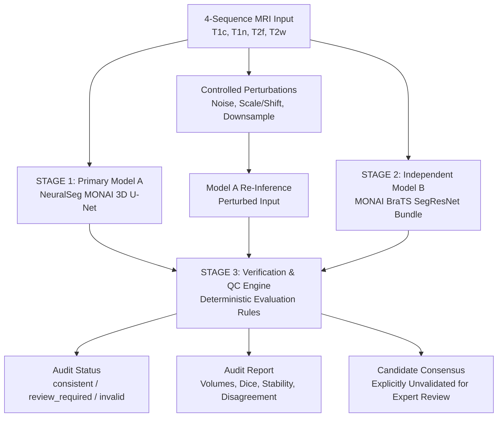

# ShiftMRI — Multi-Model Brain Tumor Segmentation Audit

> **RESEARCH PROTOTYPE ONLY — NOT CLINICALLY VALIDATED — NOT A DIAGNOSTIC TOOL**  
> ShiftMRI is an open-source research prototype investigating model reliability, perturbation stability, and multi-model disagreement in brain tumor segmentation.  
> It does **not** provide clinical diagnoses, malignancy assessments, prognostic evaluations, or treatment recommendations. A change in model prediction under perturbation or disagreement between models does **not** prove that any prediction is clinically correct or incorrect.


> 

>


---

## 1. Problem Statement

Deep learning segmentation algorithms are increasingly incorporated into neuro-oncology research workflows and quantitative imaging pipelines. Clinicians and researchers rely on tumor sub-region volume estimates—Whole Tumor (WT), Tumor Core (TC), and Enhancing Tumor (ET)—to assess treatment response, measure progression, and plan radiation therapy.

However, standard validation frameworks typically report only aggregate metrics (e.g., mean Dice coefficient across a static, held-out test cohort). These summary statistics obscure critical vulnerabilities:
- **Perturbation Fragility**: Realistic, minor differences in image acquisition—such as subtle scanner noise, intensity scaling shifts, or resolution variations across slice axes—can produce large swings in estimated tumor volumes.
- **Single-Model Blind Spots**: Relying on a single deep neural network leaves pipelines vulnerable to silent failures, spatial hallucinations, and boundary leakages that pass undetected without independent cross-verification.
- **Lack of Systematic Auditing**: Existing tools rarely evaluate whether an individual prediction is stable or whether independent models agree before volumes are reported.

---

## 2. ShiftMRI Research Question & Hypothesis

Rather than proposing a new neural architecture or claiming clinical superiority, ShiftMRI investigates a focused scientific hypothesis:

> **Central Hypothesis**:  
> *"Can independent model predictions, controlled perturbation testing, and explicit disagreement checks identify unstable tumor-volume measurements more effectively than relying on a single segmentation model?"*

### Specific Research Inquiries:
1. **Perturbation Sensitivity**: Do controlled, deterministic perturbations (Gaussian noise, intensity scale/shift, anisotropic downsampling) induce substantial volume instability in the baseline model?
2. **Stability vs. Accuracy**: Does prediction stability (agreement Dice between perturbed and unperturbed predictions) correlate with ground-truth accuracy when expert annotations are available?
3. **Multi-Model Disagreement**: Can independent secondary model predictions identify ambiguous boundaries and flag unreliable segmentations for human expert review?

---

## 3. Related Work and Upstream Attribution

ShiftMRI builds directly upon existing open-source medical imaging foundations. **No novelty is claimed for tumor segmentation architectures, basic uncertainty estimation, or standard data augmentation techniques.**

| Project / Literature | Relationship to ShiftMRI |
|---|---|
| **[AndrewVFranco/NeuralSeg](https://github.com/AndrewVFranco/NeuralSeg)** | **Direct upstream repository.** ShiftMRI preserves the original NeuralSeg MONAI 3D U-Net architecture, training scripts, preprocessing pipeline, and FastAPI inference server unchanged under the MIT License. |
| **[LauraMoraB/BrainTumorSegmentation](https://github.com/LauraMoraB/BrainTumorSegmentation)** | BraTS segmentation using MONAI U-Net; similar baseline architecture and volumetric segmentation framing. |
| **[AICONSlab/roodmri](https://github.com/AICONSlab/roodmri)** | MRI robustness and out-of-distribution evaluation toolbox; conceptually the closest prior art for image perturbation evaluation. |
| **[MONAI BraTS Bundle (NGC)](https://catalog.ngc.nvidia.com/orgs/nvidia/monaintoolkit/models/monai_brats_mri_segmentation)** | Pretrained SegResNet / U-Net pipeline for BraTS multi-parametric MRI, used as the reference target for independent Model B verification. |
| **Longitudinal & Multi-Model MRI Literature** | Studies on inter-scanner variability (e.g., Glocker et al., Roy et al.) and consensus segmentation (e.g., STAPLE algorithm, Warfield et al.). |

ShiftMRI's specific contribution is developing a standardized, transparent audit pipeline that couples deterministic perturbation testing with multi-model agreement verification to flag unreliable volumetric measurements.

---

## 4. Dataset Options, Permissions, and Data Handling

### 4.1 BraTS 2023 GLI Challenge Dataset (Authorized Real MRI)
The primary real-world benchmark is the **BraTS 2023 Adult Glioma (GLI)** challenge dataset:
- **Source**: Available via Synapse under accession `syn51514105` ([Synapse BraTS 2023](https://www.synapse.org/Synapse:syn51514105)).
- **Access & Permissions**: Requires official registration, institutional affiliation, and acceptance of the RSNA-ASNR-MICCAI BraTS Data Use Agreement. Non-commercial research use only.
- **Redistribution Policy**: **Strictly prohibited from redistribution.** Never commit raw MRI data, patient identifiers, or derived scans to Git.
- **Directory Layout**: Users with authorized access must place downloaded scans in `data/raw/`:
  ```
  data/raw/ASNR-MICCAI-BraTS2023-GLI-Challenge-TrainingData/
    BraTS-GLI-00000-000/
      BraTS-GLI-00000-000-t1c.nii.gz   # T1-weighted contrast-enhanced (T1Gd)
      BraTS-GLI-00000-000-t1n.nii.gz   # T1-weighted non-contrast (native)
      BraTS-GLI-00000-000-t2f.nii.gz   # T2-weighted Fluid Attenuated Inversion Recovery (FLAIR)
      BraTS-GLI-00000-000-t2w.nii.gz   # T2-weighted
      BraTS-GLI-00000-000-seg.nii.gz   # Ground-truth multi-class segmentation mask
  ```

### 4.2 Label Definitions and Sub-Regions
Input channels must strictly follow the 4-sequence ordering: `[t1c, t1n, t2f, t2w]`.  
Segmentation labels follow standard BraTS conventions:
- **0**: Background / Normal Brain Parenchyma
- **1**: Necrotic Tumor Core (`NCR`)
- **2**: Peritumoral Edematous Tissue / Vasogenic Edema (`ED`)
- **3**: Contrast-Enhancing Viable Tumor (`ET`)

Evaluated composite sub-regions:
- **Whole Tumor (WT)**: $\text{NCR} \cup \text{ED} \cup \text{ET} = \{1, 2, 3\}$
- **Tumor Core (TC)**: $\text{NCR} \cup \text{ET} = \{1, 3\}$
- **Enhancing Tumor (ET)**: $\text{ET} = \{3\}$

### 4.3 High-Fidelity Synthetic Phantom Cohort (Software Verification)
To test pipeline plumbing and automated quality control without requiring multi-gigabyte external downloads:
- ShiftMRI includes a built-in synthetic generator (`src/shiftmri/dataset_generator.py`).
- Generates 3D multi-parametric volumes with ellipsoidal parenchyma, gray/white matter boundaries, ventricular CSF, and multi-compartment tumors (NCR, ED, ET).
- **Labeling Rule**: Every case produced by this generator is explicitly tagged with `data_source: synthetic_phantom`. **Synthetic outputs must never be presented as clinical or biological evidence.**
- Generate a test cohort:
  ```bash
  python -m src.shiftmri.dataset_generator --num-cases 6 --out-dir data/synthetic
  ```

### 4.4 Data Partitioning & Leakage Prevention
- Partitioning (`data/splits/splits.json`) enforces strict patient-level separation across `train`, `val`, and `test` splits.
- Test cases are never used for model selection, threshold tuning, or prompt calibration.

---

## 5. Three-Stage Verification Architecture

ShiftMRI employs a transparent three-stage audit workflow:



### Stage 1: Primary Model (Model A)
- **Model**: Pretrained MONAI 3D U-Net from NeuralSeg (`checkpoints/best_model.pth`, ~57 MB).
- **Input Channels**: 4 channels (`t1c`, `t1n`, `t2f`, `t2w`).
- **Inference**: Sliding window inference (`roi_size=(128, 128, 128)`, `sw_batch_size=1`, `overlap=0.25`), followed by channel argmax.
- **Output**: Canonical 3D segmentation mask with physical region volumes (in mL).

### Stage 2: Independent Model Verification (Model B)
- **Model**: MONAI BraTS MRI Segmentation bundle (e.g., SegResNet).
- **Implementation & Blocker Status**: A standardized model adapter is implemented in `src/shiftmri/models.py`. In accordance with safety rules, external weight downloads are not executed automatically. When secondary weights are not provided locally, the adapter reports:
  ```
  status: not_available_locally
  blocker: Pretrained weights for Model B not bundled in repository; external download prohibited.
  ```
- If a secondary checkpoint is provided via `--model-b-checkpoint`, it executes independently on the same original MRI, adapts outputs to `CanonicalSegmentation`, and computes inter-model agreement metrics.

### Stage 3: Verification and Quality Control Engine
- **Nature of Stage 3**: **This is a deterministic verification engine, NOT a third neural network.**
- Evaluates model predictions against rigorous engineering heuristics and consistency checks:
  1. **Input Integrity**: Detects missing sequences, invalid shapes, non-finite values (NaN / Inf).
  2. **Label Range**: Rejects predictions outside $\{0, 1, 2, 3\}$.
  3. **Empty Mask Detection**: Flags cases where 0 tumor voxels are detected.
  4. **Perturbation Stability**: Checks whether agreement Dice $\ge 0.85$ and relative volume shift $\le 15.0\%$.
  5. **Inter-Model Disagreement**: Checks whether inter-model Dice $\ge 0.80$ when Model B is active.
  6. **Biophysical Consistency**: Checks that enhancing tumor voxels exhibit positive contrast uptake ($I_{\text{T1c}} - I_{\text{T1n}} \ge 0.20$).
- **Structured Audit Statuses**:
  - `consistent_within_tested_limits`: Passed all input checks, perturbation stability, and inter-model agreement thresholds.
  - `review_required`: Valid input, but perturbation instability or inter-model disagreement exceeds safety thresholds.
  - `invalid_input`: Corrupted inputs, missing sequences, or non-finite values.
  - `verification_incomplete`: Secondary model unavailable or ground-truth annotations absent.
- **Candidate Consensus Representation**: When multiple models run, exact class agreements generate a candidate consensus mask labeled `unvalidated_candidate_for_expert_review`. Original model predictions are always preserved intact.

---

## 6. Perturbation Methodology

Perturbations are implemented in `src/shiftmri/perturbations.py` using pure NumPy/SciPy. Transformations are applied to preprocessed inputs (z-scored within brain mask) to ensure they are visible to the model:

| Perturbation Name | Type | Configured Parameters | Rationale & Context |
|---|---|---|---|
| `noise_sigma0.1` | Gaussian Noise | $\sigma = 0.1$ | Mild thermal scanner noise (within augmentation boundary) |
| `noise_sigma0.2` | Gaussian Noise | $\sigma = 0.2$ | Elevated acquisition noise |
| `scale0.9_shift0` | Scale & Shift | $\alpha = 0.9, \beta = 0.0$ | Mild intensity scaling reduction |
| `scale1.1_shift0` | Scale & Shift | $\alpha = 1.1, \beta = 0.0$ | Mild intensity scaling increase |
| `scale1.0_shift+0.1`| Scale & Shift | $\alpha = 1.0, \beta = +0.1$ | Uniform intensity shift |
| `scale1.0_shift-0.1`| Scale & Shift | $\alpha = 1.0, \beta = -0.1$ | Uniform intensity shift |
| `scale0.8_shift+0.2`| Scale & Shift | $\alpha = 0.8, \beta = +0.2$ | Combined scale and baseline shift |
| `downsample_2x_ax2` | Downsample & Restore | Factor = 2, Axis = 2 | Simulates thicker slice acquisition along z-axis |
| `downsample_3x_ax2` | Downsample & Restore | Factor = 3, Axis = 2 | Simulates anisotropic clinical acquisition protocols |

### Mathematical and Implementation Safeguards:
- **Determinism**: Stable per-case seeds derived via SHA-256 (`_case_seed`).
- **Input Immutability**: Returns new `float32` arrays; never mutates input arrays.
- **Zero-Background Preservation**: Background voxels outside the brain mask are strictly maintained at 0.0.
- **Anti-Aliasing**: Downsampling utilizes anti-aliased spline interpolation before nearest-neighbor restoration.

---

## 7. Metrics and Reproducibility

1. **Physical Tumor Volume (mL)**:
   $$\text{Volume (mL)} = \frac{\prod_{i=1}^{3} \text{spacing}_i \text{ (mm)}}{1000} \times \sum \text{voxels}$$
2. **Volume Changes**:
   - Signed Change: $\Delta V = V_{\text{pert}} - V_{\text{base}}$
   - Absolute Change: $|\Delta V|$
   - Relative Change: $\frac{\Delta V}{V_{\text{base}}} \times 100\%$ (handled safely as `null` when $V_{\text{base}} = 0$)
3. **Dice Similarity Coefficient**:
   $$\text{Dice}(A, B) = \frac{2 |A \cap B|}{|A| + |B|}$$
   Reported separately as **Agreement Dice** (stability between baseline and perturbed predictions) and **Ground-Truth Dice** (accuracy against expert labels).
4. **95% Hausdorff Distance (HD95)**: Computed in physical millimeters using voxel spacing.
5. **Spearman Rank Correlation ($\rho$)**: Evaluates correlation between prediction stability (Agreement Dice) and ground-truth accuracy (GT Dice). Reported only when sample size $n \ge 5$ and neither variable is constant.

---

## 8. Clinician Review and Feedback Store

ShiftMRI includes a dedicated clinician verification and grading schema (`src/shiftmri/doctor_review.py`):
- Records clinician verifications (`approved`, `approved_with_edits`, `flagged`, `rejected`), star ratings (1–5), multi-dimensional grades (AI proposal, audit helpfulness, consensus quality), feedback tags, and clinical notes.
- **Storage**: Reviews are persisted independently in `data/doctor_reviews/reviews.json`.
- **Strict Safety Constraint**: **Clinician feedback is stored strictly for human auditing and retrospective evaluation. Feedback is NEVER automatically used to retrain or modify model weights.**

---

## 9. Installation and Quick Start

### 9.1 Environment Setup
Requires Python 3.10+ (tested on Python 3.10, 3.11, 3.12, and WSL2 Ubuntu):

```bash
# Clone the repository
git clone https://github.com/AndrewVFranco/NeuralSeg.git
cd NeuralSeg

# Create and activate virtual environment
python3 -m venv .venv
source .venv/bin/activate       # On Windows: .venv\Scripts\activate

# Install dependencies
pip install -r requirements.txt
```

### 9.2 Reproducing the Experiment

#### Option A: Synthetic Demo (No dataset or GPU required)
Runs the complete audit pipeline using the synthetic phantom cohort:
```bash
python -m src.shiftmri.run \
    --synthetic-demo \
    --no-hd95 \
    --output-dir outputs/shiftmri/demo
```

#### Option B: Full Audit on Processed BraTS Data
Runs Model A inference, controlled perturbations, and Stage 3 verification:
```bash
python -m src.shiftmri.run \
    --data-dir data/processed \
    --input-mode processed \
    --split test \
    --checkpoint checkpoints/best_model.pth \
    --config configs/shiftmri.yaml \
    --output-dir outputs/shiftmri/run1 \
    --seed 42
```

#### Option C: Quick Audit on a Subset of Cases
```bash
python -m src.shiftmri.run \
    --data-dir data/processed \
    --split test \
    --max-cases 5 \
    --no-hd95 \
    --output-dir outputs/shiftmri/quick
```

### 9.3 Running Tests
The test suite validates perturbations, metrics, loaders, CLI behavior, and the Stage 3 verifier without requiring GPU hardware:
```bash
# Run all unit tests
pytest tests/ -v

# Run verifier and model tests specifically
pytest tests/test_shiftmri_verifier.py tests/test_shiftmri_metrics.py tests/test_shiftmri_cli.py -v
```

---

## 10. How to Read Audit Outputs

Audit runs generate three standardized artifacts in `--output-dir`:

| File | Format | Description |
|---|---|---|
| `results.csv` | CSV | Case-by-case and perturbation-by-perturbation tabular results (status, volumes, stability metrics, GT metrics). |
| `results.json` | Strict JSON | Standards-compliant JSON serialization of all experimental records (`null` used for non-computable numeric values; no non-standard `NaN` literals). |
| `report.json` | JSON | Aggregate experiment report including per-perturbation medians, verification status tallies, Spearman correlation, and model provenance. |

### Key Result Columns:
- `status`: Audit status (`ok`, `error`, `skipped`).
- `verification_status`: Stage 3 quality control status (`consistent_within_tested_limits`, `review_required`, `invalid_input`, `verification_incomplete`).
- `agreement_wt_dice`: Stability indicator between baseline and perturbed predictions (1.0 = identical).
- `perturbed_gt_wt_dice`: Accuracy indicator against expert ground truth.
- `wt_vol_rel_pct`: Relative Whole Tumor volume shift under perturbation.

> **Caution**: High stability does **not** equal high accuracy. A model may make identical errors across all perturbations (high agreement Dice) while remaining inaccurate against ground truth. Both metrics must be interpreted jointly.

---

## 11. Limitations and Open Research Questions

1. **Simulated Perturbations vs. Multi-Center Heterogeneity**: Simulated Gaussian noise and axis downsampling are engineering approximations; they do not fully replicate real-world scanner variability (e.g., B0/B1 field inhomogeneities, motion artifacts, differing RF coils).
2. **Single Baseline Checkpoint**: Results reflect the specific weights in `checkpoints/best_model.pth`. Findings may not generalize to other model architectures or training objectives.
3. **Model B Availability**: Due to strict safety constraints prohibiting automated weight downloads, Model B runs only when a local checkpoint is provided by the user.
4. **Heuristic Nature of Thresholds**: Stability thresholds ($\text{Dice} \ge 0.85$, $|\Delta V| \le 15\%$) are transparent engineering heuristics, not clinically calibrated diagnostic limits.
5. **No Medical Claims**: This system does not claim to eliminate hallucinations, guarantee zero false positives, or provide diagnostic answers.

---

## 12. License and Attribution

- **NeuralSeg Baseline**: Upstream codebase and checkpoint licensed under the [MIT License](LICENSE) by Andrew V. Franco.
- **ShiftMRI Research Package**: ShiftMRI audit modules (`src/shiftmri/`, `tests/test_shiftmri_*.py`, `configs/shiftmri.yaml`) licensed under the MIT License.
- **BraTS 2023 GLI Data**: Governed by the RSNA-ASNR-MICCAI BraTS Challenge Data Use Agreement (non-commercial research only).
- **MONAI**: Apache License 2.0.
- **PyTorch**: Modified BSD License.
